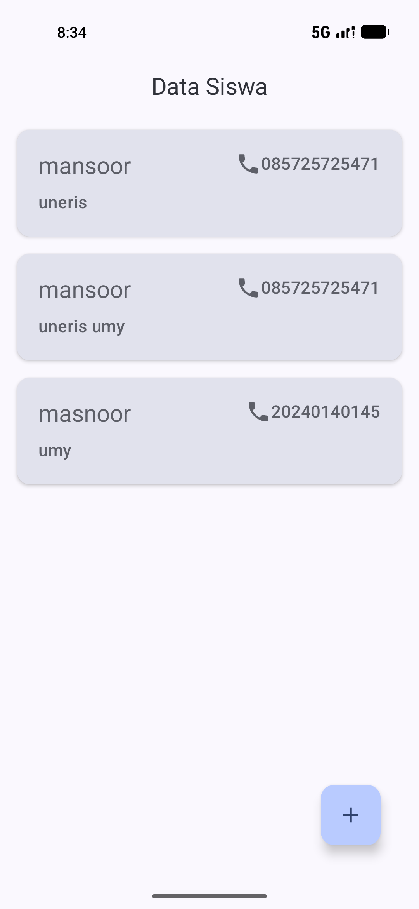
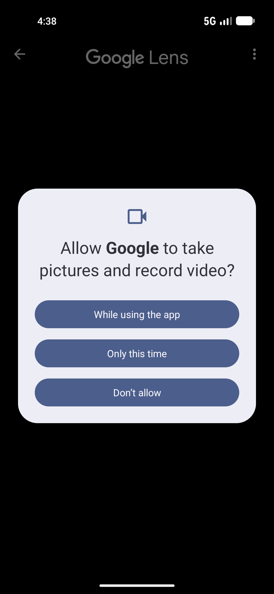

# Room Database - Data Siswa

This is a complete Jetpack Compose application that demonstrates the use of Android Room Database.
It allows users to add and list student (Siswa) data locally.

## Features
- **MVVM Architecture**: Follows the Model-View-ViewModel structure.
- **Room Database**: Local offline persistence.
- **Jetpack Compose**: Modern declarative UI toolkit for Android.
- **Navigation**: Multi-screen navigation using Compose Navigation.

## Screenshots

| Home Screen | Detail Screen | Edit Screen | Add Entry Screen |
| :---: | :---: | :---: | :---: |
|  |  |  |  |

## Getting Started

1. Clone this repository.
2. Open in Android Studio.
3. Build and run the `app` module on a connected device or emulator.
